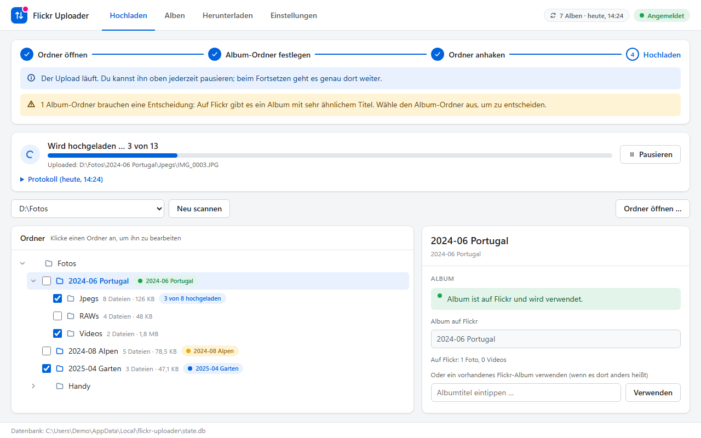

# Flickr Uploader

A Windows desktop app that uploads chosen local folders to Flickr as albums,
without duplicate photos or duplicate albums, and downloads your albums back
to your PC.



## What it does

- **Folders become albums.** You choose which folders are albums (the title
  defaults to the folder name and can be changed) and tick what goes in,
  e.g. `Jpegs` but not `RAWs`. Existing Flickr albums are recognized.
- **No duplicates.** Every upload carries a content-hash tag. Ticked folders
  are compared with the photos already on Flickr first; possible matches wait
  for your decision.
- **Resumable and verified.** Progress is saved after every file, so pausing,
  closing or a crash costs nothing. A photo only counts as uploaded once
  Flickr confirms it.
- **Always private.** Uploads are private and hidden from search. The app
  never changes the visibility of any photo.
- **Read-only on your photos.** It never writes, moves or deletes anything in
  your folders.
- **Download albums.** For each album choose videos, photos or everything.
  Files come as originals where Flickr has them, with the recording date
  written into them, each album in its own folder.

RAW files and oversized videos are skipped and listed in the log; the app
neither converts nor compresses.

## Requirements

- Windows 10 or 11 with the WebView2 runtime (preinstalled on Windows 11)
- Python 3.11 or newer
- A Flickr account and your own API key (free for non-commercial use)

## Setup

```powershell
git clone https://github.com/NihadCommits/flickr-uploader.git
cd flickr-uploader
py -3 -m venv .venv
.venv\Scripts\python.exe -m pip install -e .
.venv\Scripts\python.exe -m flickr_uploader
```

Then connect your Flickr account in the app under **Einstellungen →
Flickr-Zugang**: request an API key on Flickr, enter key and secret, allow
access on Flickr and enter the code it shows. Key, secret and login are kept
only in the Windows Credential Manager, never in a file. (The same works in a
terminal: `.venv\Scripts\python.exe -m flickr_uploader.auth setup`.)

The interface is in German.

## Usage

**Hochladen**

1. *Ordner öffnen …*: pick the folder with your photos.
2. Click a folder in the tree and choose *Als Album festlegen*.
3. Tick the subfolders to upload. A traffic light shows whether the album
   already exists on Flickr (green), will be created (blue) or needs your
   decision (yellow, e.g. a very similar title).
4. For files that may already be on Flickr, choose *Ist dasselbe Foto* or
   *Trotzdem hochladen*.
5. *Hochladen starten*. *Pausieren* stops after the current file,
   *Fortsetzen* carries on.

**Alben**: your album folders and your albums on Flickr; a folder can use an
existing album with a different name.

**Herunterladen**: tick albums, choose *Alles*, *Fotos* or *Videos* for each,
pick a target folder outside your photo folders and start.

**Einstellungen**: Flickr login, default download filter and folder, album
list at start, database location and backups.

The database and its backups live in `%LOCALAPPDATA%\flickr-uploader`. One
database belongs to one Flickr account; for a second account, set
`FLICKR_UPLOADER_HOME` to another folder before starting the app.

**Extra:** `scripts\export_albums.py` and `scripts\rename_albums.py` rename
existing Flickr albums in bulk via a CSV (dry run first, `--apply` to rename).

## License

[MIT](LICENSE). Design notes (German): [docs/PROJECT_SPEC.md](docs/PROJECT_SPEC.md).
